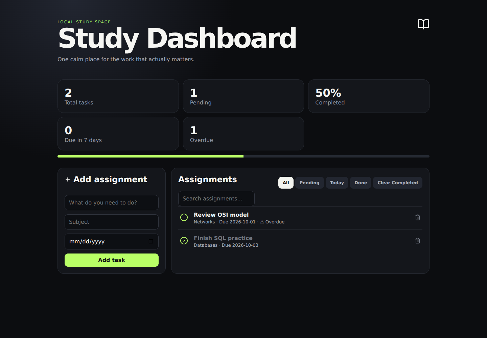

# React Study Dashboard

Dashboard académico local para tareas, materias y progreso, desarrollado con React y Vite.

Funciona sin cuentas ni backend: los datos permanecen en el navegador. Es una alternativa personal y pequeña al enfoque colaborativo de [BaseDeTareas](https://github.com/DonMilo-22/BaseDeTareas).

## Vista de la aplicación



Captura de la aplicación con sus datos de ejemplo.

## Funciones actuales

- Crear tareas con materia y fecha de entrega opcional.
- Completar y eliminar tareas; limpiar todas las completadas.
- Filtrar todas, pendientes, completadas y pendientes para hoy.
- Buscar por título o materia mientras se escribe.
- Ordenar por entrega, dejando tareas sin fecha al final.
- Mostrar progreso, entregas en los próximos siete días y tareas vencidas.
- Persistencia en `localStorage` e interfaz adaptable.

## Requisitos

Node.js 22.12 o superior dentro de la rama 22, o una rama posterior compatible, y npm. Las dependencias de React, Vite y su plugin están declaradas como `latest`: la versión instalada puede variar. Vite 8.3.4 fue la versión resuelta y compilada durante esta revisión; su requisito de Node también admite 20.19 o superior dentro de la rama 20.

## Instalación y uso local

```bash
git clone https://github.com/DonMilo-22/React-Study-Dashboard.git
cd React-Study-Dashboard
npm install
npm run dev
```

Abre la URL local que imprime Vite. Agrega una tarea, utiliza los filtros y marca su estado desde la lista.

## Compilación y vista previa

```bash
npm run build
npm run preview
```

El resultado se genera en `dist/`. `npm run preview` sirve esa compilación localmente; no publica una demo en Internet.

## Almacenamiento y límites

La clave `study-tasks` de `localStorage` conserva tareas por origen del navegador. Cambiar navegador, dispositivo o dirección crea un almacenamiento distinto. Borrar los datos del sitio elimina las tareas. No hay sincronización, exportación ni sistema de cuentas. Las fechas se comparan usando la fecha local del dispositivo.

## Comprobaciones

`npm run build` comprueba la compilación. Un recorrido manual puede verificar agregar una tarea, filtrar, completar y recargar para observar la persistencia. No hay una suite automatizada declarada en `package.json`.

## Autor y licencia

Desarrollado por [DonMilo-22](https://github.com/DonMilo-22).

Licencia: MIT.

## Actualización 2026-10-12

- Added an `Undated` dashboard counter for pending assignments without a due date.

## Actualización adicional 2026-10-12

- The progress bar now has a text label showing completed assignments out of the total.

## Historial

Consulta [CHANGELOG.md](CHANGELOG.md) para ver las actualizaciones.

## Actualización 2026-10-14

- Added an `overdue` filter to group unfinished assignments past their due date.

## Actualización 2026-10-15

- Added a `week` filter for pending assignments due today through the next seven days.


## Actualización 2026-10-16

- Added an **Export CSV** action to download assignments with subject, due date, and completion status for use in spreadsheet apps.
